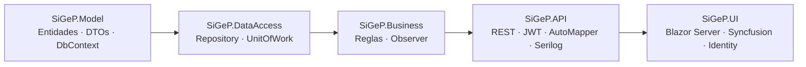

<p align="center">
  
</p>

<p align="center">
  
  
  
  
  
  
</p>

<p align="center">
  <b>Gestión de pacientes, médicos, turnos, historias clínicas y pagos</b><br>
  API REST con JWT + frontend Blazor Server, en una solución por capas sobre .NET 8.
</p>

---

## ✨ Qué es

**SiGeP** es una aplicación para administrar el día a día de un consultorio o clínica: alta de **pacientes** y **médicos**, agenda de **turnos**, **historia clínica**, **pagos** y **recordatorios**. Está pensada como base de referencia de arquitectura n-tier en .NET 8 (Repository + Unit of Work, Observer, DTOs con AutoMapper).

| | |
|---|---|
| 🧱 **Capas claras** | `Model → DataAccess → Business → API → UI`, dependencias siempre hacia abajo. |
| 🔐 **Autenticación JWT** | Login contra la API; la UI guarda los claims en una cookie de sesión. |
| 🗃️ **Soft delete + auditoría** | Toda entidad hereda `BaseEntity` (Id, creado/modificado/borrado) y se filtra de forma global. |
| 🔔 **Observer** | Notificaciones de pagos y recordatorios de turnos desacopladas de la lógica de negocio. |
| 📜 **Logging** | Serilog con sink a SQL Server (`DatabaseLogsSiGeP`). |

## 🗺️ Arquitectura



| Proyecto | Responsabilidad |
|---|---|
| `SiGeP.Model` | Entidades de dominio (`Customer`, `Doctor`, `Appointment`, `Address`, `MedicalRecord`, `Payment`, `Reminder`…), DTOs y `DbModelContext` (EF Core 8). |
| `SiGeP.DataAccess` | `GenericRepository<T>` (CRUD, paginación, SQL crudo) y `UnitOfWork`. Los repositorios se obtienen con `unitOfWork.AddRepositories.GetRepository<T>()`. |
| `SiGeP.Business` | Una clase `<Entidad>Business : BusinessBase<T>` por entidad, con validaciones y notificadores (Observer). |
| `SiGeP.API` | Controllers REST, JWT, AutoMapper, middleware de excepciones y Swagger. |
| `SiGeP.UI` | Frontend Blazor Server con Syncfusion, Identity (login/cookie) y FluentValidation. |

## 🚀 Inicio rápido

**Requisitos:** SDK de .NET 8, SQL Server (y SSMS opcional).

```bash
# 1. Clonar
git clone <url-del-repo>
cd SiGeP

# 2. Crear las bases DatabaseSiGeP y DatabaseLogsSiGeP en SQL Server
#    y ajustar los connection strings (preferible con user-secrets)
dotnet user-secrets set "ConnectionStrings:DefaultConnection" "<cadena>" --project SiGeP.API

# 3. Aplicar migraciones
dotnet ef database update --project SiGeP.Model --startup-project SiGeP.API --context DbModelContext

# 4. Levantar API (Swagger + JWT) y luego la UI
dotnet run --project SiGeP.API
dotnet run --project SiGeP.UI
```

> [!NOTE]
> Los nombres exactos de las claves de configuración están en `SiGeP.API/appsettings.json`. La UI requiere la API en ejecución.

<details>
<summary><b>Migraciones EF Core</b></summary>

```bash
dotnet ef migrations add <Nombre> --project SiGeP.Model --startup-project SiGeP.API --context DbModelContext
dotnet ef database update          --project SiGeP.Model --startup-project SiGeP.API --context DbModelContext
```
</details>


## 📚 Documentación

| Documento | Contenido |
|---|---|
| [Arquitectura](SiGeP/Guia%20Desarrollo/ReadmeArquitecture.md) | Relevamiento detallado: patrones, seguridad, convenciones y plantillas por capa. |
| [Estructura](SiGeP/Guia%20Desarrollo/Estructura.md) | Árbol de carpetas comentado de los 5 proyectos. |
| [Bitácora API](SiGeP/Documentacion/Readme.md) | Pasos de alta: EF Core, UnitOfWork, AutoMapper, JWT, Serilog. |
| [Bitácora UI](SiGeP/Documentacion/Readme.UI.md) | Blazor Server, Syncfusion, Identity, FluentValidation. |
| [Angular (idea)](SiGeP/Documentacion/Angular.md) | Notas sobre un frontend alternativo, no implementado. |
